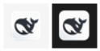
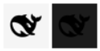

# DSHView

> A ~1MB portable window that bundles Microsoft's fixed-version WebView2 runtime, so a **locked-down intranet Windows box without WebView2 and without admin rights** can still open the [DeepSeek Harness](https://github.com/deepseek-ai) web GUI.

English | [中文](README.md)

## Why this exists

The DeepSeek Harness web GUI needs a Chromium engine. The typical intranet situation is awkward:

- Win10/Server VMs usually have **no WebView2 runtime** (Server ships without it, and slimmed images often strip it)
- Installing software, requesting admin rights, or downloading a runtime from the internet is not allowed
- Shipping a whole Chrome/Edge is heavy for a box with 2–4GB of RAM

DSHView's approach: **put Microsoft's official fixed-version WebView2 runtime in the same folder as the executable** and point `browserExecutableFolder` at it. Nothing is registered, nothing lands in system directories, no admin rights are needed. Delete the folder and it is gone.

## Features

- **Zero install**: ships Chromium `157.0.4341.46` (fixed version); the target machine needs no WebView2 at all
- **Content-only window**: no address bar or buttons by default (`toolbar=1` brings them back)
- **Truly portable**: no registry writes, no service, nothing in system directories
- **Low memory**: GPU and background networking are disabled; ~129MB private memory on an empty page
- **Clipboard works**: intranet http origins are promoted to a secure context, so `navigator.clipboard` behaves
- **Four icon modes**: official artwork / follow system theme / fixed dark whale / fixed white whale
- **Asks before closing, and remembers**: closing prompts you to pick "minimize to the tray" (the session survives) or "quit"; tick "remember my choice" and it stops asking
- **Tray menu**: show window / copy current address / developer tools / open in browser / settings / about / quit
- **Settings and about dialogs**: a sectioned card that rewrites the ini in place (comments kept), and an about page with one-click copy
- **Self-diagnosing**: log file, self-test mode, and a startup failure dialog that names the file to edit

## Quick start

```
1. Unzip the whole folder onto the target machine (e.g. D:\DSHView\)
2. Edit `url` in dshview.ini
3. Double-click DSHView.exe
```

## Building

This repository ships **source only**: the runtime folder is 510MB and does not belong in git (GitHub rejects files over 100MB). The build script fetches what is missing.

```powershell
# Windows PowerShell 5.1 (ships with Windows)
powershell -ExecutionPolicy Bypass -File .\build.ps1
powershell -ExecutionPolicy Bypass -File .\build.ps1 -Zip

# or PowerShell 7+
pwsh ./build.ps1 -Zip
```

**Incremental by default**: when the output folder already holds a complete runtime plus the three SDK assemblies, the 248MB download and the 510MB copy are skipped and only the executable is recompiled (~1 second). `-Force` re-assembles the runtime but still reuses the packages in `build/.cache` instead of downloading them again. The first build needs network access; after that it rebuilds offline as long as the cache or the output folder survives.

What it does:

1. Downloads `WebView2.Runtime.X64` and `WebView2.Runtime.X64.Core` (which carries `msedge.dll`) from NuGet and merges them into `webview2/`
2. Pulls the three assemblies of the official `Microsoft.Web.WebView2` SDK
3. Compiles `src/Program.cs` with the in-box .NET Framework `csc.exe`
4. Assembles a folder you can copy straight to the target machine

No Visual Studio, no .NET SDK, no NuGet client required. The build machine needs access to `api.nuget.org`; the produced folder runs fully offline.

> Downloads resume with `curl -C -` because a 260MB pull over a flaky proxy gets truncated easily.

## Configuration (`dshview.ini`)

| Key | Default | Meaning |
|---|---|---|
| `url` | `http://127.0.0.1:3080/` | DSH Web address; include `?token=...` on first use or after a port change |
| `runtime` | `webview2` | bundled runtime; `system` uses the machine-installed WebView2 |
| `data` | `profile` | browser data directory (cookies, login state); deleting it clears the login |
| `zoom` | `1.0` | initial zoom |
| `toolbar` | `0` | `1` shows the address bar, back/forward and zoom |
| `icon` | `default` | `default` / `auto` / `light` / `dark` |
| `lang` | `auto` | `auto` follows the dsh web UI / `zh` always Chinese / `en` always English |
| `closeaction` | `ask` | `ask` prompts every time / `tray` always minimizes to the tray / `quit` always exits (the legacy `closetotray=1` still means `tray` when this key is absent) |
| `args` | empty | extra Chromium flags |
| `secureorigin` | `1` | promote http intranet origins to a secure context (needed for clipboard) |

The file is recreated automatically when missing.

## Icons

Four values for `icon`. Each row shows the same setting rendered **on a light background (left) and a dark one (right)**:

| Value | Light / dark | Notes |
|---|---|---|
| `default` |  | Official DSH artwork (rounded backdrop + whale), the default. Carries its own light backdrop, so it reads on both backgrounds |
| `auto` |  | Follows the system theme: dark whale on light, white whale on dark; reads `AppsUseLightTheme` |
| `light` |  | Always the dark whale. Good on a light title bar; hard to see on a dark one |
| `dark` |  | Always the white whale. Good on a dark title bar; hard to see on a light one |

The **static file icon** of the exe is always `default` (what Explorer shows); only the window and taskbar icon follow the setting.

## Closing and the tray

With the default `closeaction=ask`, closing the window **asks first**: minimize to the notification area, or quit. That way a stray click on the × cannot end a session you were reading.

- *Minimize to the tray*: the window leaves the taskbar (it holds no taskbar slot), the process keeps running, and the DSH session is not interrupted
- *Quit*: the application exits
- The dialog's ×, `Esc`, or *Cancel*: nothing happens, the window stays open
- Tick **"remember my choice"** and the answer is written to `closeaction` (`tray` or `quit`), so the question is not asked again
- To change it by hand: `closeaction` = `ask` / `tray` / `quit`
- Double-click the tray icon → restore the window (keeping its maximized/normal state)
- Right-click the tray icon → *Show window* / *Copy current address* / *Developer tools* / *Open in system browser* / *Settings…* / *About* / *Quit*

> The tray icon now **always** exists (not only when minimizing to the tray): a content-only window has no address bar, so the tray is the only menu surface.

## Settings and about

*Settings…* in the tray menu (or the gear on the right of the toolbar when `toolbar=1`):

- Sections: **Connection** (address, runtime, secure context) / **Appearance** (icon, zoom, address bar) / **Behaviour** (close button, UI language) / **Advanced** (extra Chromium arguments, data directory)
- Footer: open config file · cancel · save · **save and restart**
- Saving writes only the values that changed, in place, so comments and ordering survive. Address / runtime / data directory / zoom changes need a restart; the new process waits for the old one to exit, so two instances never race for the same `profile` directory

*About* shows the version, the WebView2 runtime and where it came from, the data directory, config file, log path, project URL and licence, with *Copy info* to paste into a ticket.

**UI language**: with `lang=auto` (the default) menus and dialogs follow the dsh web UI by reading `document.documentElement.lang` (the dsh client mirrors its active locale there; Chinese is `zh-CN`). Switching the language inside dsh web takes effect **immediately, with no reload**: an observer injected into the page watches `<html lang>` and the theme attributes and tells the host to re-read, and a few probes at 0/600/1200 ms after each load cover the late arrival of the dsh settings scope. `lang=zh` or `lang=en` pins one.

## About tokens

- Authentication is **mandatory**, including on `127.0.0.1` — dsh has no "loopback is exempt" tier.
- **The token changes on every start**: it is a random launch token minted by the dsh process, never written to disk, and there is no environment variable or CLI flag that pins it.
- You only need it **once**: `GET /?token=...` is exchanged for a signed cookie, and the browser authenticates with that cookie from then on.
- The cookie is bound to the **authority** (the `host:port` in the Host header, plus the scheme over https). Its signing secret is persisted server-side in `$DSH_HOME/.credentials.yaml`, it lasts 30 days by default, and it **survives a `dsh web` restart** as long as the authority and that secret stay the same.

### Use a fixed port (strongly recommended)

`dsh web` picks a random port by default (`--port 0`), so the port changes on every restart. A new authority invalidates the cookie and the client has to be handed a fresh token URL. Pin the port and the authority stays stable:

```powershell
dsh web --host 10.0.0.123 --port 3080 --no-open
```

With a fixed port:

- After a `dsh web` restart the **old address in the client still connects**, even when the token inside it is long dead. Authentication is the cookie's job, not the URL's: a stale `?token=` is ignored and the request is redirected to `./`.
- You only need to paste a fresh address when the cookie itself is gone: a changed host / port / scheme, more than `cookieMaxAgeDays`, `$DSH_HOME/.credentials.yaml` deleted or moved to another home, or the client's `data` directory cleared.
- `url` in `dshview.ini` does not need to change while the authority stays the same, and leaving the old token in it does no harm.

Cookie lifetime can be raised on the server:

```yaml
- name: '@deepseek-ai/dsh-client-connection'
  config:
    cookieMaxAgeDays: 3650
```

The lifetime is stamped at issue time, so re-authenticate once after changing it. And only raise it — lowering it immediately invalidates cookies already issued, because validation requires `expiresAt - issuedAt <= cookieMaxAgeDays`.

## Deploying across two machines

Server (say `10.0.0.123`):

```powershell
dsh web --host 10.0.0.123 --port 3080 --no-open
```

- Binding only `127.0.0.1` keeps it local; remote clients cannot reach it
- `--host 0.0.0.0` is rejected on purpose; name one concrete address
- Keep the port **fixed** (`3080` above). `--port 0` picks a new port on every restart, which invalidates the cookie and forces the client to be handed a fresh token URL; see "Use a fixed port" above
- It prints `dsh web: http://10.0.0.123:3080/?token=...` — hand that whole line to the client

Client `dshview.ini`:

```ini
url=http://10.0.0.123:3080/?token=xxxxxxxx   ; first run
url=http://10.0.0.123:3080/                  ; after authentication
```

When reaching it through a DNS name or reverse proxy, the server also needs `--trusted-host`, otherwise the Host check answers 403.

## Troubleshooting

```powershell
DSHView.exe --selftest --url=file:///C:/Windows/win.ini
```

This writes `selftest-result.json`; `"ok":true` with `"version":"157.0.4341.46"` means the host and kernel are fine and the problem is network or token related.

- `dshview.log` records every start, the resolved runtime folder, kernel version, icon choice, navigation result and stack traces
- On a runtime init failure the dialog lists every folder that was probed; verify `webview2\` contains `msedgewebview2.exe`, `msedge.dll` and `157.0.4341.46.manifest`
- Blank page with `no connection` / `Access denied` in the log: a security product is blocking Chromium's sandbox IPC; add `--no-sandbox` temporarily to confirm

## Layout

```
src/Program.cs        main program (WinForms + WebView2, C# 5, single file)
src/*.ico             three icon sets
src/Icon*.cs          icon generation helpers (not part of the main build)
src/IcoExtract.cs     extracts RT_GROUP_ICON from a PE verbatim
build.ps1             one-command build
dshview.ini           configuration template
docs/ic-*.png        icons on light/dark backgrounds (used by the README table)
```

## Notes

- Icons come from the official DSH install (`resources/icon.png`) and DSH-Portable's icon resources, used only to make this tool recognisable
- This project is not affiliated with DeepSeek
- Prebuilt package: [Releases](https://github.com/ljh575/dshview-client/releases)

## License

[MIT](LICENSE)
