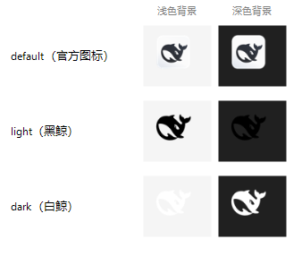

# DSHView

> 一个 ~1MB 的绿色窗口程序，自带固定版 WebView2 运行时，让**没有 WebView2、不能装软件、内存紧张的内网 Windows 机器**也能用上 [DeepSeek Harness](https://github.com/deepseek-ai) 的 Web GUI。

[English](README.en.md) | 中文



## 为什么需要它

DeepSeek Harness 的 Web GUI 需要 Chromium 内核。典型的内网场景却很尴尬：

- Win10/Server 虚拟机**没有安装 WebView2 运行时**（Server 默认不带，精简镜像也常被裁掉）
- 不允许装软件、没有管理员权限、也连不上外网下载运行时
- 装一整个 Chrome/Edge 太重，而内存只有 2–4GB

DSHView 的做法是：**把微软官方固定版 WebView2 运行时和程序放在同一个文件夹里**，用 `browserExecutableFolder` 指过去，不写注册表、不进系统目录、不需要管理员权限。删掉文件夹即卸载。

## 特性

- **零安装**：自带 Chromium `157.0.4341.46` 固定版运行时，目标机无需任何 WebView2
- **纯内容窗口**：默认没有地址栏和按钮，只有页面本身（`toolbar=1` 可调出）
- **真正的绿色**：不写注册表、不装服务、不落系统目录
- **省内存**：默认关闭 GPU 与后台网络，空页面私有内存约 129MB
- **剪贴板可用**：自动把内网 http 源提升为安全上下文，`navigator.clipboard` 正常工作
- **四档图标**：官方图标 / 跟随系统主题 / 固定黑鲸 / 固定白鲸
- **失败可自查**：日志、自检模式、启动失败时直接告诉你要改哪个文件

## 快速开始

```
1. 解压整个文件夹到目标机（例如 D:\DSHView\）
2. 编辑 dshview.ini 里的 url
3. 双击 DSHView.exe
```

## 构建

仓库**只放源码**：运行时目录有 510MB，不适合进 git（GitHub 单文件上限 100MB）。构建脚本会把缺的部分补回来。

```powershell
# Windows 自带的 Windows PowerShell 5.1
powershell -ExecutionPolicy Bypass -File .\build.ps1
powershell -ExecutionPolicy Bypass -File .\build.ps1 -Zip

# 或者 PowerShell 7+
pwsh ./build.ps1 -Zip
```

**增量构建**：输出目录里已有完整运行时和三个 SDK 程序集时，会跳过 248MB 下载与 510MB 拷贝，只重新编译 exe（约 1 秒）。加 `-Force` 则重新组装运行时（`build/.cache` 里的包仍然复用，不会重新下载）。首次构建必须联网；之后只要缓存或输出目录还在，离线也能重建。

脚本做的事：

1. 从 NuGet 下载 `WebView2.Runtime.X64` 与 `WebView2.Runtime.X64.Core`（含 `msedge.dll`），合并成 `webview2/`
2. 从 `Microsoft.Web.WebView2` 取官方 SDK 的三个程序集
3. 用 Windows 自带的 .NET Framework 编译器 `csc.exe` 编译 `src/Program.cs`
4. 组装出可直接拷走的目录

不需要 Visual Studio、不需要 .NET SDK、不需要 NuGet 客户端；构建机需要能访问 `api.nuget.org`，产物运行完全离线。

> 下载环节对代理抖动做了断点续传（`curl -C -`），因为 260MB 的包在弱网下经常被截断。

## 配置（`dshview.ini`）

| 键 | 默认 | 说明 |
|---|---|---|
| `url` | `http://127.0.0.1:3080/` | DSH Web 地址；首次或换端口时带上 `?token=...` |
| `runtime` | `webview2` | 用自带运行时；`system` 表示用系统已装的 WebView2 |
| `data` | `profile` | 浏览器数据目录（存 cookie/登录态），删掉等于清空登录 |
| `zoom` | `1.0` | 初始缩放 |
| `toolbar` | `0` | `1` 显示地址栏与前进/后退/缩放 |
| `icon` | `default` | `default` / `auto` / `light` / `dark` |
| `args` | 空 | 追加给 Chromium 的参数 |
| `secureorigin` | `1` | 把 http 内网源提升为安全上下文（剪贴板需要） |

文件缺失时程序会自动重建。

## 图标

`icon` 四档：

| 值 | 用的图 | 说明 |
|---|---|---|
| `default` | DSH 官方图标（圆角底 + 鲸鱼） | 默认，浅底深底都能看清 |
| `auto` | 跟随系统主题：浅色黑鲸、深色白鲸 | 读 `AppsUseLightTheme` |
| `light` | 始终黑鲸 | 标题栏是浅色时用 |
| `dark` | 始终白鲸 | 标题栏是深色时用 |

exe 的**静态文件图标**固定是 `default`（资源管理器里看得到）；只有窗口/任务栏图标按设置切换。

## 关于 token

- 访问 dsh 的 Web 界面**必须**认证，本机 `127.0.0.1` 也不例外——dsh 没有"回环地址免认证"这一层。
- 但只需要**一次**：`GET /?token=...` 后会写入一个绑定 `host:port` 的签名 cookie，默认 30 天，且签名密钥持久化，**dsh web 重启后 cookie 依然有效**。
- token 本身无法固定：它是 dsh 进程内存里的随机值，不落盘，也没有配置项或命令行开关。
- 想让凭据更长寿，在服务器侧把 cookie 寿命调长：

  ```yaml
  - name: '@deepseek-ai/dsh-client-connection'
    config:
      cookieMaxAgeDays: 3650
  ```

  注意：有效期在签发时写入，改完要重新认证一次才生效。

## 部署到另一台机器

服务器（假设 `10.0.0.123`）：

```powershell
dsh --profile web --host 10.0.0.123 --port 3080 --no-open
```

- 不能只绑 `127.0.0.1`，否则跨机连不上
- `--host 0.0.0.0` 不被支持，必须写具体地址
- 启动后会打印 `dsh web: http://10.0.0.123:3080/?token=...`，把这一整行给客户端

客户端 `dshview.ini`：

```ini
url=http://10.0.0.123:3080/?token=xxxxxxxx   ; 首次
url=http://10.0.0.123:3080/                  ; 认证后
```

用 DNS 名或反向代理时，服务器还要加 `--trusted-host`，否则会被 Host 校验拦成 403。

## 排障

```powershell
DSHView.exe --selftest --url=file:///C:/Windows/win.ini
```

生成 `selftest-result.json`，`"ok":true` 且 `"version":"157.0.4341.46"` 说明宿主与内核正常，问题在网络或 token。

- `dshview.log` 记录每次启动、运行时目录、内核版本、图标选择、导航结果与异常栈
- 提示运行时初始化失败时，对话框会列出所有尝试过的目录；确认 `webview2\` 里有 `msedgewebview2.exe`、`msedge.dll`、`157.0.4341.46.manifest`
- 页面空白且日志出现 `no connection` / `Access denied`：安全软件拦了 Chromium 沙箱 IPC，可临时加 `--no-sandbox` 定位

## 目录结构

```
src/Program.cs        主程序（WinForms + WebView2，C# 5，单文件）
src/*.ico             三套图标资源
src/Icon*.cs          图标生成/合成工具（生成 ico 用的，不参与主程序编译）
src/IcoExtract.cs     从 PE 里原样导出 RT_GROUP_ICON
build.ps1             一键构建
dshview.ini           配置模板
docs/icons.png        图标效果图
```

## 说明

- 图标取自 DSH 官方安装目录的 `resources/icon.png` 与 DSH-Portable 的图标资源，仅作本工具识别用途
- 本项目与 DeepSeek 官方无关
- 预编译包见 [Releases](https://github.com/ljh575/dshview-client/releases)

## License

[MIT](LICENSE)
